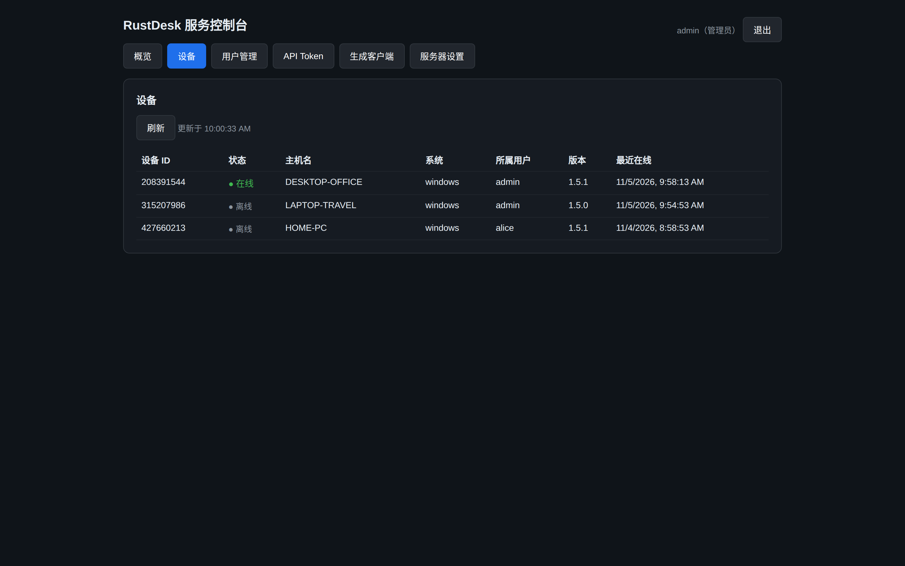

# rustdesk-server-pro (self-hosted fork)

English | [中文](README.md)

A self-hosted remote desktop server based on the official open-source [rustdesk-server](https://github.com/rustdesk/rustdesk-server): an account system and web admin console on top of the official hbbs / hbbr; the official RustDesk client works with it without any modification.

> This project is an independent fork and is not affiliated with the official paid RustDesk Server Pro. License: AGPL-3.0, same as upstream.

📖 **[Chinese notes (with screenshots)](docs/中文说明.md)** | 📦 **[Deployment guide](docs/DEPLOY-en.md)** | 📦 **[部署文档（中文）](docs/DEPLOY.md)**



## Extra features over the official open-source edition

- **Account system**: registration / login (the first registered account becomes admin); console login protected by an image captcha; the official client signs in with the same account, and devices are auto-bound to their owner account
- **Web console** (default port 21114): user management, device list, server settings, API token management; device and user lists are scoped per account — regular users only see their own
- **Generate client**: one-click generation of an official client with the server address and key pre-bound (server settings hidden in the client UI); each generation yields a tokenized download link, and deleting the generation record invalidates the link; any signed-in user can generate for themselves
- **Manual config card**: the console shows the ID server / relay server / API server / key directly, so existing official clients can join by filling in the four values
- **Token API**: API tokens with the `rdt_` prefix; the server only stores their SHA-256 hash
- **Security hardening**: brute-force lockout on login (per-account + per-IP), an open-registration switch, separate listeners for the management plane and client endpoints (`--console-listen`), optional HTTPS (`--tls-cert` / `--tls-key`)
- **Heartbeat strategy push**: pushes "hide server settings" to clients, optionally "allow remote config modification"
- **Geo-nearest multi-relay selection**: optional MaxMind city-level GeoIP database (`geoip-city.mmdb`); picks the nearest relay by the summed geographic distance to both peers, falling back to the official round-robin when the database is missing or coordinates cannot be resolved
- **Relay node management**: a resident agent (relay-agent) runs on each relay host; the console generates a one-time registration link to enroll it; the server pushes the keypair and config (port, speed limits, restart) over encrypted channels, and the device list shows relay node status (online/offline, sessions, throughput) — click a node name for details
- **Windows service support**: `winservice/` provides the rdsvc.exe service host and management scripts to register hbbs / hbbr as auto-start Windows services
- **Runtime files stay put**: everything the server produces at runtime (databases, logs, keys, etc.) lands in the server program's own directory
- **Template download**: hbbs has a built-in downloader with mirror fallback that fetches the latest official client as the generation template
- **ARM64 support**: aarch64 glibc and musl static packages; the musl build runs on OpenWrt soft-routers
- **Online one-click update**: check GitHub Releases from the console, read the full changelog, download and stage, auto-replace on restart
- **Other-platform download links**: official macOS / Linux / Android / iOS download links, plus a mirror-acceleration checkbox
- **One-click copy config**: generates a config string in the same format as the official Pro console's — paste it into the official client to import
- **Console Chinese/English switch**: Chinese by default; the choice is remembered
- **Require-login switch**: when on, clients that have not logged in cannot establish connections — TCP, UDP, and WebSocket are all blocked
- **Main-deployment relay key validation**: the main deployment's hbbr runs with `-k -`, so clients with a mismatched key are refused on relay
- **KX encryption on the 21116 control channel**: secure_tcp KX v0 encrypts login traffic; old clients can still connect in plaintext
- **Console URL state**: the current section is written to the address bar hash, so a refresh no longer returns to the overview

## Version changelog

- **Before v28**: the foundations — account system, web console, client generation, security hardening, and more
- **v28**: fixed the device database escaping its directory on Windows + service.bat menu
- **v29**: merged upstream relay UUID validation hardening
- **v30**: merged upstream hardening (message size limits, etc.); added ARM64 Linux packages (glibc / musl)
- **v31**: fixed "File name too long" for generated clients with long domains
- **v32**: online one-click update + API usage docs
- **v33**: other-platform official download links + one-click copy config
- **v34**: console Chinese/English switch + English deployment guide + download mirror checkbox
- **v35**: require-login switch
- **v36**: relay node management (registration + config push + status)
- **v37**: main-deployment relay key validation (hbbr with `-k -`)
- **v38**: KX encryption on the 21116 control channel (secure_tcp KX v0) + console URL state (hash routing; refresh no longer returns to the overview) + "Last relay used" column in the device list
- **v39**: admins create users directly in user management (works with registration closed; creating a user does not sign the admin out)

## Quick start

See [docs/DEPLOY-en.md](docs/DEPLOY-en.md) for deployment, upgrades, and per-version change notes.

## Build

```bash
cargo build --release
```

This produces hbbs, hbbr, and rustdesk-utils. The Windows service host lives in `winservice/` and is built with Go.

Upstream base for this fork: rustdesk-server commit `873230e` (hbbs 1.1.17-dev).

## License

[AGPL-3.0](LICENSE). Based on the official open-source RustDesk server — thanks to the RustDesk team.
