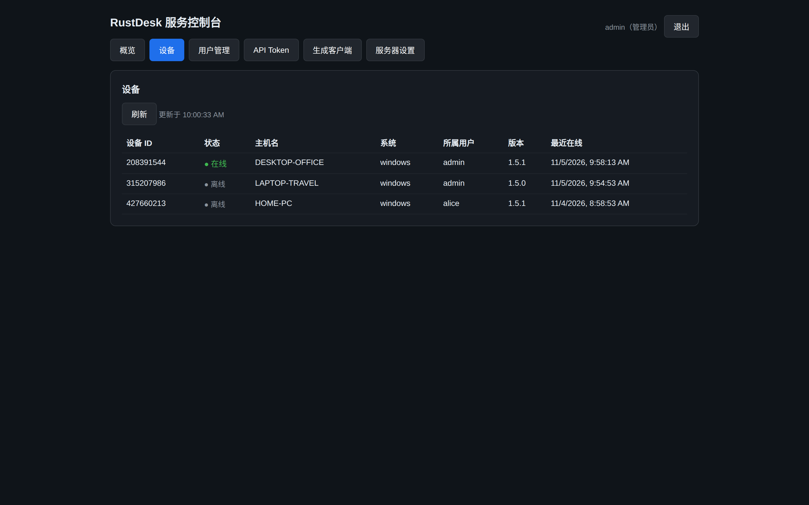

# rustdesk-server-pro（自建二开版）

基于官方开源 [rustdesk-server](https://github.com/rustdesk/rustdesk-server) 二次开发的自建远程桌面服务端：在官方 hbbs / hbbr 之上增加账号系统与 Web 管理控制台，官方 RustDesk 客户端无需任何修改即可使用。

> 本项目是独立的二次开发分支，与官方付费版 RustDesk Server Pro 无关。许可证为 AGPL-3.0，与上游一致。

📖 **[中文说明（含运行截图）](docs/中文说明.md)** ｜ 📦 **[部署文档](docs/DEPLOY.md)**



## 相比官方开源版增加的功能

- **账号系统**：注册 / 登录（首个注册账号即管理员），控制台登录带图形验证码；官方客户端可用同一账号登录，设备按账号自动绑定
- **Web 控制台**（默认 21114 端口）：用户管理、设备列表、服务器设置、API 令牌管理；设备与用户列表按账号隔离，普通用户只看自己的
- **生成客户端**：在控制台一键生成预绑定服务器地址与密钥的官方客户端（服务器配置在客户端界面中隐藏），每次生成得到一条令牌化下载链接，删除生成记录即让链接失效；任意已登录用户可为自己生成
- **手动配置卡片**：控制台直接显示 ID 服务器 / 中继服务器 / API 服务器 / 密钥，存量官方客户端照着填即可接入
- **Token API**：`rdt_` 前缀的 API 令牌，服务端只保存 SHA-256 哈希
- **安全加固**：登录防爆破锁定（账号 + IP 两级）、开放注册开关、管理面与客户端接口分开监听（`--console-listen`）、可选 HTTPS（`--tls-cert` / `--tls-key`）
- **心跳策略下发**：向客户端下发「隐藏服务器设置」，可选下发「允许远程修改配置」
- **多中继就近选路**：可选配 MaxMind 城市级地理库（`geoip-city.mmdb`），按连接两端地理距离之和选择最近的中继；无库或查不到坐标时自动回退官方轮询
- **Windows 服务支持**：`winservice/` 提供服务宿主 rdsvc.exe 与管理脚本，可将 hbbs / hbbr 注册为开机自启的 Windows 服务
- **运行文件归位**：服务端运行时产生的文件（数据库、日志、密钥等）全部落在服务端程序所在目录

## 快速开始

部署、升级与各版本变更说明见 [docs/DEPLOY.md](docs/DEPLOY.md)。

## 构建

```bash
cargo build --release
```

产物为 hbbs、hbbr、rustdesk-utils。Windows 服务宿主在 `winservice/` 目录下用 Go 构建。

二次开发所基于的上游版本：rustdesk-server 提交 `873230e`（hbbs 1.1.17-dev）。

## 许可

[AGPL-3.0](LICENSE)。本项目基于 RustDesk 官方开源服务端开发，感谢 RustDesk 团队。
