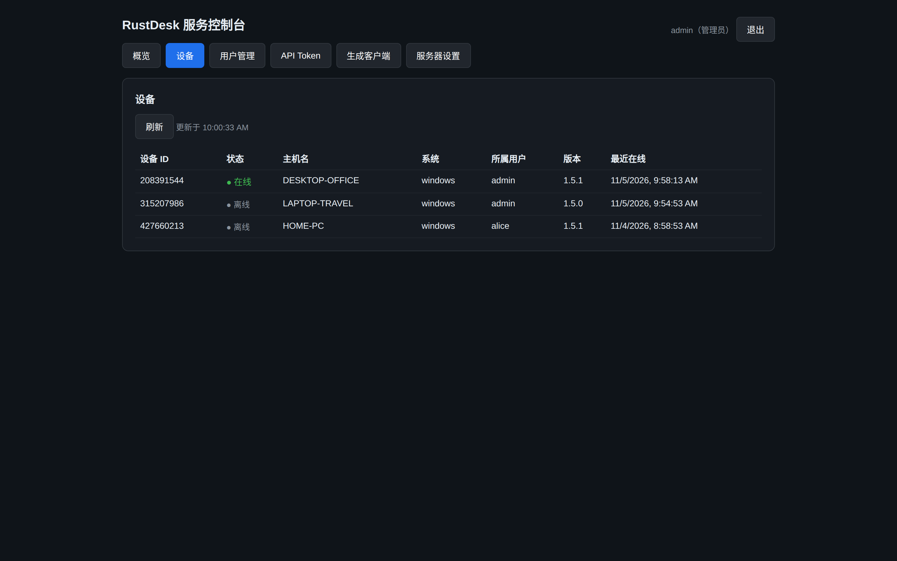

# rustdesk-server-pro（自建二开版）

[English](README-en.md) | 中文

基于官方开源 [rustdesk-server](https://github.com/rustdesk/rustdesk-server) 二次开发的自建远程桌面服务端：在官方 hbbs / hbbr 之上增加账号系统与 Web 管理控制台，官方 RustDesk 客户端无需任何修改即可使用。

> 本项目是独立的二次开发分支，与官方付费版 RustDesk Server Pro 无关。许可证为 AGPL-3.0，与上游一致。

📖 **[中文说明（含运行截图）](docs/中文说明.md)** ｜ 📦 **[部署文档](docs/DEPLOY.md)** ｜ 📦 **[Deployment guide (English)](docs/DEPLOY-en.md)**



## 相比官方开源版增加的功能

- **账号系统**：注册 / 登录（首个注册账号即管理员），控制台登录带图形验证码；官方客户端可用同一账号登录，设备按账号自动绑定
- **Web 控制台**（默认 21114 端口）：用户管理、设备列表、服务器设置、API 令牌管理；设备与用户列表按账号隔离，普通用户只看自己的
- **生成客户端**：在控制台一键生成预绑定服务器地址与密钥的官方客户端（服务器配置在客户端界面中隐藏），每次生成得到一条令牌化下载链接，删除生成记录即让链接失效；任意已登录用户可为自己生成
- **手动配置卡片**：控制台直接显示 ID 服务器 / 中继服务器 / API 服务器 / 密钥，存量官方客户端照着填即可接入
- **Token API**：`rdt_` 前缀的 API 令牌，服务端只保存 SHA-256 哈希
- **安全加固**：登录防爆破锁定（账号 + IP 两级）、开放注册开关、管理面与客户端接口分开监听（`--console-listen`）、可选 HTTPS（`--tls-cert` / `--tls-key`）
- **心跳策略下发**：向客户端下发「隐藏服务器设置」，可选下发「允许远程修改配置」
- **多中继就近选路**：可选配 MaxMind 城市级地理库（`geoip-city.mmdb`），按连接两端地理距离之和选择最近的中继；无库或查不到坐标时自动回退官方轮询
- **中继节点管理**：中继机器上跑常驻代理 relay-agent，控制台生成一次性注册链接完成注册；服务端加密下发密钥对与配置（端口、限速、重启），设备列表展示中继节点状态（在线/离线、会话数、吞吐），点节点名查看详情
- **Windows 服务支持**：`winservice/` 提供服务宿主 rdsvc.exe 与管理脚本，可将 hbbs / hbbr 注册为开机自启的 Windows 服务
- **运行文件归位**：服务端运行时产生的文件（数据库、日志、密钥等）全部落在服务端程序所在目录
- **模板下载**：hbbs 内置下载器，带镜像回退，自动取最新版官方客户端做生成模板
- **ARM64 支持**：aarch64 glibc 与 musl 静态包，musl 版可跑在 OpenWrt 软路由上
- **在线一键更新**：控制台查 GitHub Release、看完整更新日志、下载暂存、重启自动替换
- **其他平台下载链接**：macOS / Linux / Android / iOS 官方下载直链，另有镜像加速复选框
- **一键复制配置**：生成与官方 Pro 控制台同格式的配置串，粘贴导入官方客户端
- **控制台中英切换**：默认中文，选择会记住
- **必须登录开关**：开启后未登录客户端无法建立连接，TCP / UDP / WS 三条路都不放行
- **主部署中继密钥校验**：主部署 hbbr 加 `-k -`，密钥不一致的客户端走中继会被拒
- **21116 控制通道 KX 加密**：secure_tcp KX v0，登录流量加密；旧客户端仍可明文接入
- **控制台 URL 状态**：当前区写进地址栏 hash，刷新不再回到首页

## 版本功能日志

- **v28 之前**：账号系统、Web 控制台、生成客户端、安全加固等基础能力
- **v28**：修 Windows 下设备数据库外溢 + service.bat 菜单
- **v29**：同步上游中继 UUID 校验加固
- **v30**：同步上游加固（消息大小上限等）；新增 ARM64 Linux 包（glibc / musl）
- **v31**：修生成客户端长域名「File name too long」
- **v32**：在线一键更新 + API 调用说明
- **v33**：其他平台官方下载链接 + 一键复制配置
- **v34**：控制台中英切换 + 英文部署文档 + 下载镜像加速复选框
- **v35**：必须登录开关
- **v36**：中继节点管理（注册 + 配置下发 + 状态查看）
- **v37**：主部署中继密钥校验（hbbr 加 `-k -`）
- **v38**：21116 控制通道 KX 加密（secure_tcp KX v0）+ 控制台 URL 状态（hash 路由，刷新不再回到首页）+ 设备列表「最近使用的中继」列
- **v39**：用户管理里管理员直接建号（关闭注册后可建号，建号不顶掉管理员登录）
- **v40**：连接审计日志（控制台「审计日志」页：谁/何时/从哪/到哪/是否中继/时长）
- **v40.1（预览版）**：地址簿自动加入已绑定设备（「登录设备」分组；字段与 sctgdesk 对齐已验证）
- **v41**：自助修改密码（普通用户在控制台改自己的密码，校验旧密码；改密码后其他设备登录失效）
- **v42**：控制台体验修复（改密码面板加「取消」，用户管理列表为主视图）+ 模板版本检测（本地已是最新版时跳过重新下载）
- **v43**：审计会话回收（丢了关闭记录的会话按心跳判定结束，离线超 24 小时的设备会话按离线结束）+ 中继推断（public_host 计入中继 IP 集合）+ 控制台表格按 responsive-table 指南重建（滚动容器、粘性表头、窄屏卡片式）
- **v44**：检测更新按钮修复（无更新结果后按钮恢复可用）+ API Token 创建后改名（创建返回 id，横幅里改名）+ 表格截断格点展（点一下展开全文，鼠标/键盘/触屏都可用）
- **v45**：中继详情页地址回退到心跳 IP + 新增端口行 + API Token 页重做为 API key（共用名称框、「添加 API key」、不再预填 "default"）+ --api-listen 默认 [::]:21114（Refs #12，绑不上 IPv6 时回退 0.0.0.0）+ Docker 镜像（CI 构建发布到 GHCR，整数版移动 latest）
- **v46**：控制台页脚「关于项目」+ 侧边栏导航（左侧竖直可折叠，窄屏收为图标栏）+ API key 页名称改为备注（备注框在横幅里跟在 key 后面）+ 中继 agent 自报公网 IP（地址显示：注册地址 > 上报公网 IP > 心跳来源 IP；中继需手动换 relay-agent）+ 更新区「检测预览版」复选框（默认不勾选，预览版构建带完整版本号）+ 审计日志日期范围选择器（from/to 参数，服务端本地时间）+ 模板下载按地区排序（国内镜像优先，国外直连优先）
- **v46.1（预览版）**：Docker 运行时数据落进数据卷（Fixes #13）：RD_SKIP_ANCHOR=1 跳过工作目录锚定，s6 与经典镜像在镜像内设置该变量，key-secret 注入的密钥能被读到；CI 预览标签构建导出 PRO_FULL_VERSION，预览版 Docker 镜像带完整版本号；smoke 扩展为双镜像数据落卷检查；升级前先把旧容器 `/usr/bin` 下的数据拷到 `/data` 卷，否则重建后丢失；已部署的中继节点无需更新

## 快速开始

部署、升级与各版本变更说明见 [docs/DEPLOY.md](docs/DEPLOY.md)。

## 中继节点与分布式部署

### 中继节点

中继节点是一台跑 hbbr 的机器，外加一个常驻代理 relay-agent。hbbr 本身从不连接 hbbs，所以由代理负责注册、心跳、接收配置下发，并监督本地 hbbr 进程。

- **注册**：控制台「设备」页生成一次性注册链接（默认 24 小时有效，只显示一次），中继机器上运行 `relay-agent register --link <链接>`。注册走 HMAC 质询-响应，服务端用 AES-256-GCM 加密下发节点 id、服务器密钥对与初始配置。注册链接即凭证，用完即删。
- **密钥校验**：代理以 `hbbr -p <端口> -k -` 启动 hbbr，强制校验客户端密钥（不带 `-k` 时 hbbr 不校验任何密钥）；密钥文件缺失时拒绝启动，绝不放一个无密钥的中继出去。
- **心跳与配置**：代理每 20 秒上报状态（加密后签名）；控制台可下发端口与三项限速（端口变化重启 hbbr，只改限速即时生效），可远程重启 hbbr。节点删除即吊销：代理停心跳，hbbr 继续服务。
- **控制台查看**：管理员在「设备」页看到中继子表：在线/离线（按最后心跳 90 秒判）、地址、版本、会话数与吞吐。地址显示优先级：注册地址 > 代理上报的公网 IP > 心跳来源 IP。
- **注册不等于加入轮询**：注册只建立管理关系，不会自动把节点加入中继轮询列表——轮询列表由主服务器启动参数 `RELAY_SERVERS` 决定（见下）；管理员可在中继详情页点「加入轮询列表 / 从轮询移除」按钮加入或移除，点一下即生效，server.env 同步更新；删除节点时同步从轮询列表里删掉。
- **中继节点不能在线更新**：代理只推配置与重启，从不推二进制；换版本要手动替换中继机器上的 hbbr 与 relay-agent（步骤见「中继部署与更新」）。

### 分布式部署

一台主服务器（hbbs + API + 控制台）加多台中继节点（分布在不同机房或 VPS）：

1. 主服务器照常部署。
2. 每台中继机器按「中继部署与更新」一节安装并注册 relay-agent。中继端口必须能从两端客户端连到（默认 21117 TCP，WebSocket 在端口 +2；NAT 后面要做端口转发）；代理连主服务器 API（默认 21114）走出站连接，注册与心跳不受中继机器自身 NAT 影响。
3. 主服务器 `server.env` 里把各中继地址逗号分隔写进 `RELAY_SERVERS`（公网 IP 或可公网解析的域名，可带端口，默认 21117），改完重启服务端（rdsvc 只在服务启动时读一次 server.env，要重启服务，不只是重启 hbbs）。
4. 客户端中继字段填公网地址（不带 `https://`，端口默认 21117 可省略），只改中继字段即可；生成客户端已预绑定中继地址。
5. 可选：多中继全球部署时，把 MaxMind 城市库 `geoip-city.mmdb` 放进主服务器目录（或 `RELAY_GEOIP_DB` 指定路径），开启就近选路（见下）；启动日志 `relay geo selection: enabled` 可确认。

详细步骤与注册/心跳协议见 [docs/DEPLOY.md](docs/DEPLOY.md) v36 一节与 [relayagent/README.md](relayagent/README.md)。

### 中继部署与更新

- **部署**：每个平台一个中继包（`rustdesk-server-pro-relay-*`，含 hbbr、relay-agent 与安装脚本）。Linux：解压后运行 `install-relay.sh`（装 systemd 服务 `rustdesk-relay-agent`），再 `relay-agent register --link <链接>`，最后 `systemctl start rustdesk-relay-agent`。Windows：解压后运行 `install-service.bat`（注册 `RustDeskRelayAgent` 服务），再 `relay-agent.exe register --link <链接>`，最后 `service.bat start`。ARM 软路由用 linux-aarch64-musl 中继包（hbbr 与代理都是静态链接）。被管中继上只由代理启动 hbbr，不要再用 systemd / rdsvc 直接拉 hbbr，否则两个进程抢端口。
- **更新**：停 agent 服务 → 从 GitHub Release 下载新版本的中继包 → 解压到临时目录 → 把新的 hbbr 与 relay-agent 拷进包目录覆盖（agent.json、relay.env、id_ed25519、日志不动，无需重新注册）→ 启动服务。该节点上的中继会话会中断几秒。看发布说明确认该版本是否需要更新中继：有的版本中继二进制没变，无需更新；只改了代理时只换 relay-agent 即可。

### 中继分配逻辑

hbbs 只分发中继地址，不统计会话、不做配对——配对发生在 hbbr。

- **候选列表**：只来自启动参数 `--relay-servers`（`RELAY_SERVERS`），逗号分隔，hbbs 启动时读入；注册的中继节点不自动进列表，手工改列表要重启 hbbs；控制台添加/移除会同时改 server.env 与实时列表，点一下即生效。
- **存活检查**：中继 ≥ 2 台时，hbbs 每 3 秒对每台做 TCP 探活（3 秒超时），只有连得通的进入分配名单；全部探不通时保留上一次的名单，不清空。只有 1 台时不探活，直接用它。
- **分配时机**：控制端向 hbbs 发起打洞请求时，hbbs 按两端公网 IP 选一台中继，把地址写进转发给被控端的打洞消息；直连失败时两端按该地址去中继配对。
- **选择策略**（多台时）：有地理库时选「到两端球面距离之和」最小的中继，与最优值在 1.3 倍 + 250 km 以内的组成近距离组，组内轮询分流；无地理库、某端查不到坐标（内网地址等）、或中继定位不到时，回退全量轮询。
- **客户端侧的优先级**（已对官方客户端 1.5.0 源码核实）：客户端自己的中继设置优先；没填时用 hbbs 分配的地址；都没填时用 ID 服务器地址端口 +1（默认 21117，即主服务器自带的中继）。生成客户端与手动填了中继的客户端走自己填的中继；两端都没填时，hbbs 分配的同一地址保证两端去同一台中继配对。
- **局域网特例**：被控端在局域网内时，hbbs 给出服务端内网地址；一端在内网、另一端在外网时强制走中继。

## Docker 部署

```bash
docker run -d --name rustdesk-pro \
  -p 21114:21114 -p 21115:21115 -p 21116:21116 -p 21116:21116/udp \
  -p 21117:21117 -p 21118:21118 -p 21119:21119 \
  -v rustdesk-pro-data:/data \
  -e RELAY=<服务器公网地址> \
  ghcr.io/wirh/rustdesk-server-pro:latest
```

一体镜像同时跑 hbbs + hbbr；经典镜像（`ghcr.io/wirh/rustdesk-server-pro-classic`）一个容器跑一个服务，配合仓库根目录的 `docker-compose.yml` 使用。Docker Hub 同步发布：`tesx/rustdesk-server-pro` 与 `tesx/rustdesk-server-pro-classic`。详细部署方法见 [docs/DEPLOY.md](docs/DEPLOY.md)。

数据在 `/data` 卷里（一体镜像）或挂载目录里（经典镜像）。v46 及更早的镜像把数据写进了容器内的 `/usr/bin`，升级到 v46.1 前先按 [docs/DEPLOY.md](docs/DEPLOY.md)「升级到 v46.1（数据迁移）」一节把旧数据拷出来，否则重建容器后数据丢失。

## 构建

```bash
cargo build --release
```

产物为 hbbs、hbbr、rustdesk-utils。Windows 服务宿主在 `winservice/` 目录下用 Go 构建。

二次开发所基于的上游版本：rustdesk-server 提交 `873230e`（hbbs 1.1.17-dev）。

## 许可

[AGPL-3.0](LICENSE)。本项目基于 RustDesk 官方开源服务端开发，感谢 RustDesk 团队。
