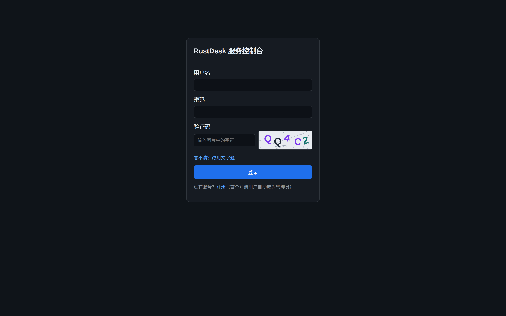
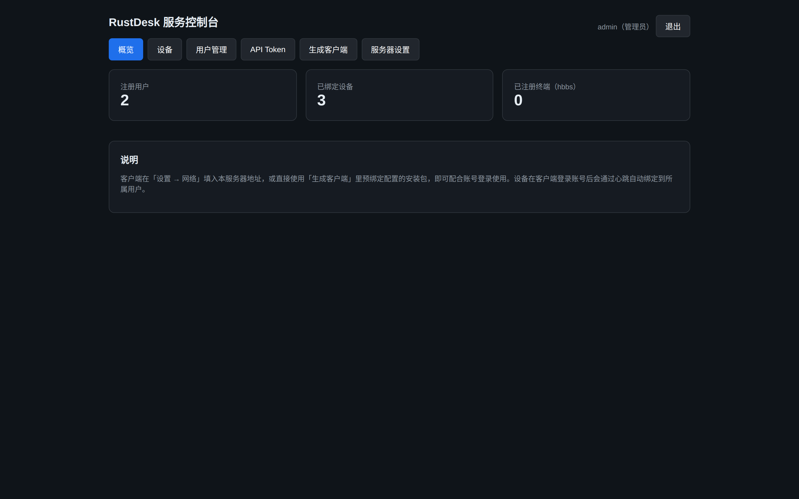
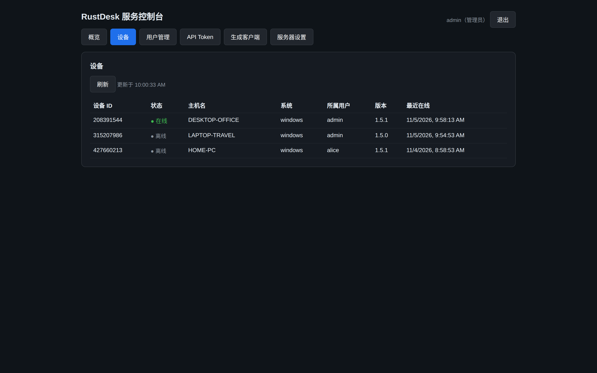
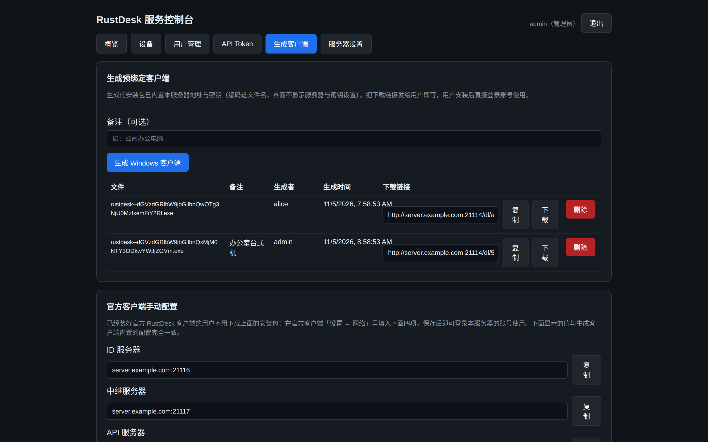
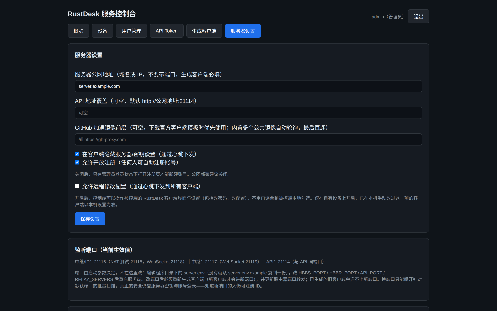

# 中文说明

## 这是什么

在官方开源 RustDesk 服务端（hbbs / hbbr）之上二次开发的自建远程桌面服务端。官方开源版只有 ID 注册与中继转发，没有账号概念；本项目在 hbbs 内补齐了**账号系统 + Web 管理控制台 + 客户端分发**这一层，让自建 RustDesk 具备类似商业远控软件的账号化管理方式。官方 RustDesk 客户端**不做任何修改**即可使用。

本项目是独立的二次开发分支，与官方付费版 RustDesk Server Pro 无关。

## 运行截图

> 以下截图来自本地演示实例（示例数据，公网地址为保留示例域名 server.example.com）。

**登录页**（图形验证码，可切换文字题；登录有防爆破锁定）

**概览**（注册用户 / 已绑定设备 / 已注册终端）

**设备列表**（设备在客户端登录账号后经心跳自动绑定到所属用户；在线状态、版本、最近在线一目了然）

**生成客户端**（一键生成预绑定服务器地址与密钥的官方客户端安装包，配置编码进文件名、客户端界面里不显示；下载走令牌链接，删除记录即失效。下半部分是给存量官方客户端用的手动配置卡片）

**服务器设置**（公网地址、API 地址覆盖、模板镜像、隐藏客户端服务器设置、开放注册开关、允许远程修改配置下发、当前生效端口）

## 相比官方开源版增加的功能

| 方面 | 官方开源版 | 本项目 |
| --- | --- | --- |
| 账号 | 无 | 注册 / 登录，首个注册账号为管理员；客户端与控制台共用账号 |
| 管理界面 | 无 | Web 控制台（默认 21114 端口）：概览、设备、用户管理、API Token、生成客户端、服务器设置 |
| 设备归属 | 无 | 客户端登录后设备自动绑定账号；设备 / 用户列表按账号隔离 |
| 客户端分发 | 手动填服务器地址和密钥 | 控制台生成预绑定安装包 + 令牌下载链接；或用手动配置卡片照填四项 |
| API | 无 | `rdt_` 前缀 Token API（仅存 SHA-256 哈希），可编程查询设备等 |
| 安全 | 仅密钥 | 登录防爆破锁定（账号 + IP）、注册开关、管理面与客户端接口分开监听、可选 HTTPS |
| 策略下发 | 无 | 心跳下发「隐藏服务器/密钥设置」，可选下发「允许远程修改配置」 |
| 多中继选路 | 轮询 | 可选地理就近：配 MaxMind 城市库后按连接两端距离选最近中继，无库自动回退轮询 |
| Windows 部署 | 手动拉起进程 | 提供 Windows 服务宿主（winservice/），可注册为开机自启服务 |
| 运行文件 | 部分写到系统用户目录 | 全部落在服务端程序所在目录，便于整目录迁移 |

## 端口一览（默认值，均可通过启动参数修改）

| 端口 | 用途 |
| --- | --- |
| 21114 / TCP | API 与 Web 控制台（可用 `--console-listen` 把控制台拆到独立地址） |
| 21115 / TCP | NAT 类型测试 |
| 21116 / TCP + UDP | ID 注册与打洞信令（UDP 必须放行） |
| 21117 / TCP | 中继转发 |
| 21118 / TCP | WebSocket（ID） |
| 21119 / TCP | WebSocket（中继） |

## 部署

完整的部署、升级、服务化与各版本变更说明见 [DEPLOY.md](DEPLOY.md)。

## 许可

AGPL-3.0（与上游一致）。基于官方开源 [rustdesk-server](https://github.com/rustdesk/rustdesk-server) 提交 `873230e` 开发，感谢 RustDesk 团队。
